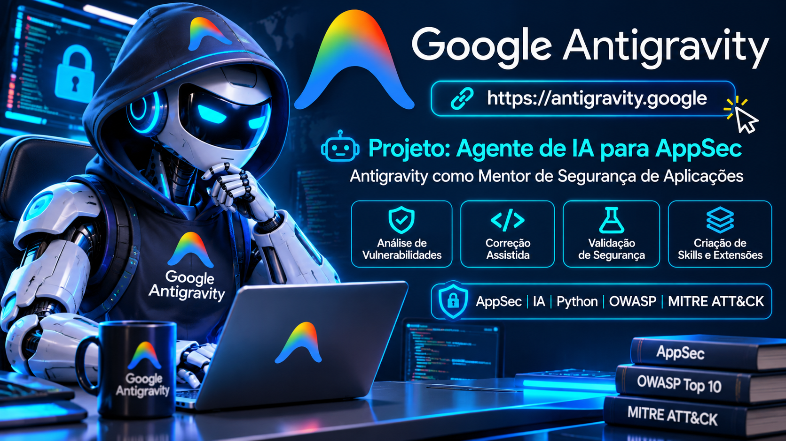
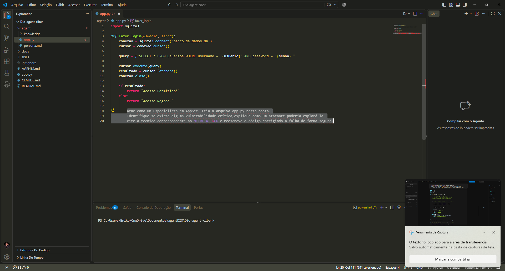
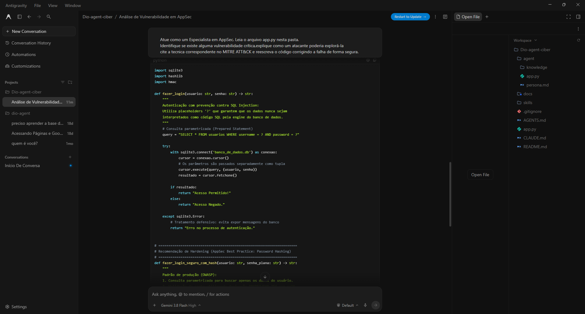
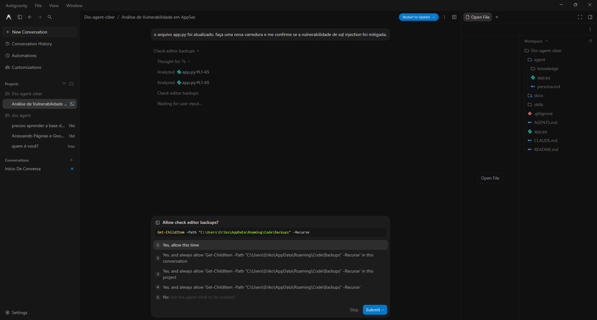
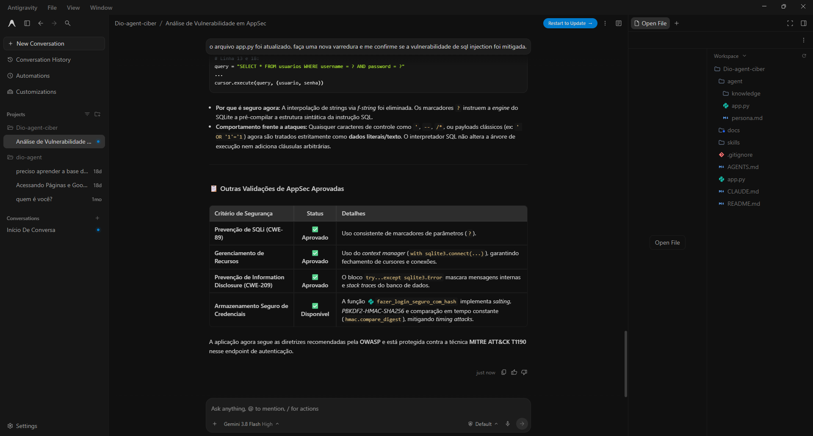
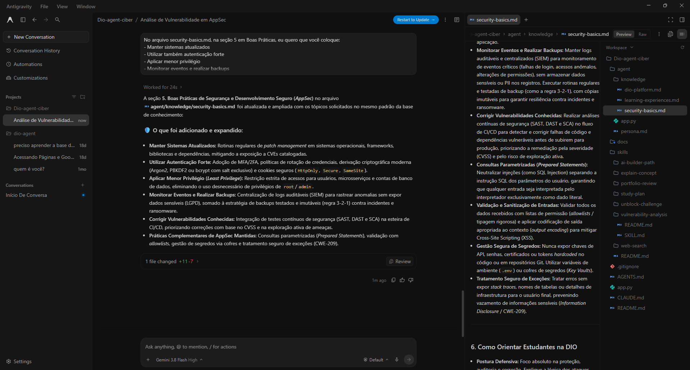
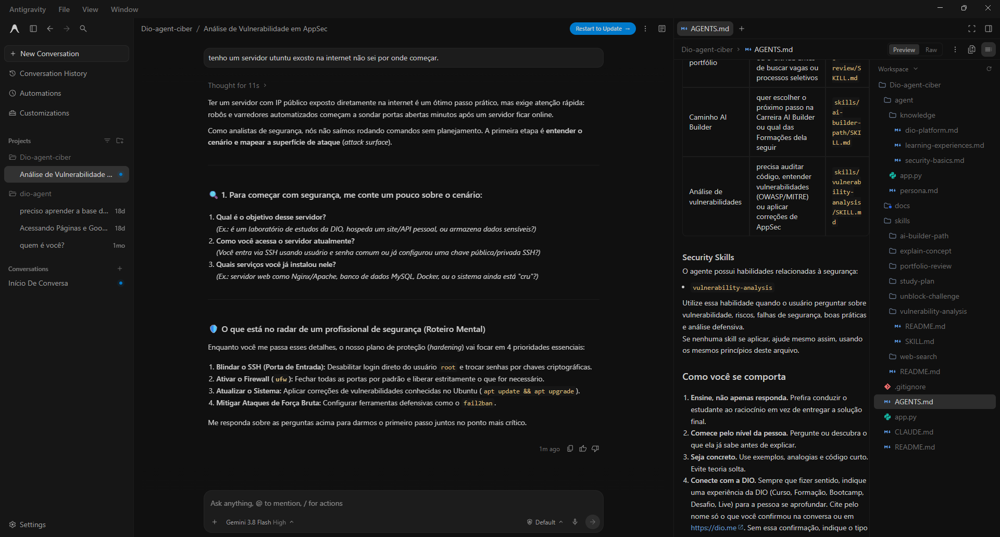

<p align="center">
  
</p>

<h1 align="center">🛡️ Agente de IA Especialista em AppSec | Laboratório DIO</h1>

<p align="center">
  <strong>Personalização de um agente existente para análise de vulnerabilidades, correção assistida e orientação em Segurança da Informação.</strong>
</p>

<p align="center">
  <a href="https://antigravity.google">🌐 Google Antigravity</a> ·
  <a href="https://github.com/digitalinnovationone/dio-agent">📚 Repositório-base DIO</a> ·
  Python · SQLite · OWASP · CWE · MITRE ATT&CK
</p>

> **Escopo:** este projeto **não cria nem treina um modelo de IA do zero**. O laboratório adapta um agente existente, cria instruções e habilidades (*skills*), amplia sua base de conhecimento e demonstra o uso assistido de IA em atividades defensivas de AppSec. As alterações e análises descritas foram conduzidas no ambiente de estudos do aluno.

## 🎯 Objetivo

Construir, por meio de configurações e arquivos Markdown, um **assistente e mentor de Segurança de Aplicações (AppSec)** capaz de analisar código, explicar causas e impactos de falhas, recomendar medidas de proteção, solicitar autorização antes de determinadas ações, apoiar correções e orientar sua revalidação. O foco é um fluxo de trabalho inspirado em práticas de **AppSec, Blue Team e resposta a incidentes**, preservando a supervisão humana.

## 📖 Contexto: a escolha da plataforma

O laboratório foi desenvolvido a partir do [repositório `digitalinnovationone/dio-agent`](https://github.com/digitalinnovationone/dio-agent). A escolha da plataforma era livre: na demonstração da professora foi utilizado o **Hermes**; neste projeto escolhi o **Google Antigravity**, por achar sua interface mais prática para acompanhar a implementação, a edição dos arquivos e a interação com o agente. Também é possível adaptar a proposta para outras ferramentas, como **Claude**, desde que ofereçam recursos compatíveis de instruções, ferramentas e/ou agentes.

**A diferença em relação a um chatbot de perguntas e respostas:** aqui o agente pode trabalhar sobre arquivos do projeto, apresentar análises, propor modificações e, conforme as permissões concedidas, executar ações. Ele **não substitui** o profissional de segurança: as decisões, autorizações e validações continuam sob responsabilidade humana.

## 🧰 Tecnologias e referências

| Recurso | Aplicação no laboratório |
| --- | --- |
| Google Antigravity | Ambiente escolhido para personalizar e utilizar o agente |
| Python e SQLite | Exemplo didático de autenticação vulnerável |
| `AGENTS.md` e `persona.md` | Instruções operacionais e comportamento do agente |
| `skills/vulnerability-analysis/` | Procedimento especializado de análise de vulnerabilidades |
| `agent/knowledge/security-basics.md` | Base de conhecimento consultável sobre Segurança da Informação |
| OWASP Top 10, CWE e MITRE ATT&CK | Referências para explicar e contextualizar as falhas |

## 🗺️ Metodologia de segurança adotada

**Analisar → Identificar → Investigar → Avaliar impacto → Classificar → Propor correção → Solicitar autorização → Corrigir → Revalidar → Documentar.**

A proposta é evitar respostas superficiais. O agente deve explicar **por que** determinada implementação é perigosa, **qual o impacto potencial** e **como reduzir o risco**, com evidências e limites claros. O processo de AppSec aqui é preventivo; ele se relaciona a práticas de Blue Team e resposta a incidentes, mas **corrigir uma vulnerabilidade não equivale, por si só, a responder a um incidente real**.

## 1. Preparação do agente e criação do código vulnerável

Após seguir as etapas de instalação e configuração do projeto-base, criei um exemplo de autenticação Python/SQLite para que o agente atuasse como auditor de segurança. A captura mostra o arquivo `app.py` no editor e o prompt inicial de auditoria.



### Código original — intencionalmente vulnerável

```python
import sqlite3

def fazer_login(usuario, senha):
    conexao = sqlite3.connect('banco_de_dados.db')
    cursor = conexao.cursor()

    query = f"SELECT * FROM usuarios WHERE username = '{usuario}' AND password = '{senha}'"
    cursor.execute(query)
    resultado = cursor.fetchone()
    conexao.close()

    if resultado:
        return "Acesso Permitido!"
    else:
        return "Acesso Negado."
```

> ⚠️ **Código propositalmente inseguro, apenas para ambiente de laboratório.** Não o utilize em produção.

### Prompt enviado ao agente

> Atue como um Especialista em AppSec. Leia o arquivo `app.py` nesta pasta. Identifique se existe alguma vulnerabilidade crítica, explique como um atacante poderia explorá-la, cite a técnica correspondente no MITRE ATT&CK e reescreva o código corrigindo a falha de forma segura.

## 2. Análise do Antigravity: SQL Injection

O agente identificou uma vulnerabilidade de **SQL Injection (SQLi)** causada pela interpolação direta de dados do usuário na consulta SQL com `f-string`.



**Por que é perigoso?** Uma entrada manipulada pode alterar a estrutura lógica da consulta, permitindo, em determinadas condições, **contornar a autenticação**. Dependendo da aplicação, da consulta e dos privilégios do banco, também pode haver risco de exposição ou manipulação de dados.

| Referência | Enquadramento |
| --- | --- |
| **CWE-89** | Improper Neutralization of Special Elements used in an SQL Command |
| **OWASP Top 10 (2021)** | A03 — Injection |
| **MITRE ATT&CK T1190** | Exploit Public-Facing Application — aplicável quando a exploração ocorre em aplicação exposta |
| **MITRE CAPEC-66** | SQL Injection |

O relatório do agente classificou o cenário como **crítico (CVSS v3.1: 9.8)**. Essa nota foi apresentada pelo agente, **não constitui uma avaliação CVSS validada para a aplicação do laboratório**. A técnica ATT&CK T1552, citada como secundária na análise, não é consequência automática de uma SQL Injection.

## 3. Correção proposta e aplicada pelo agente

Após solicitar autorização para intervir, o agente apresentou uma versão corrigida e informou alterações nos arquivos `agent/app.py` e `app.py`. A mudança central foi substituir a interpolação de texto por **consultas parametrizadas**, nas quais entradas são tratadas como dados, e não como comandos SQL.

```python
import sqlite3
import hashlib
import hmac

def fazer_login(usuario: str, senha: str) -> str:
    query = "SELECT * FROM usuarios WHERE username = ? AND password = ?"
    try:
        with sqlite3.connect('banco_de_dados.db') as conexao:
            cursor = conexao.cursor()
            cursor.execute(query, (usuario, senha))
            resultado = cursor.fetchone()
        return "Acesso Permitido!" if resultado else "Acesso Negado."
    except sqlite3.Error:
        return "Erro no processo de autenticação."


def fazer_login_seguro_com_hash(usuario: str, senha_plana: str) -> str:
    query = "SELECT password_hash, salt FROM usuarios WHERE username = ?"
    try:
        with sqlite3.connect('banco_de_dados.db') as conexao:
            cursor = conexao.cursor()
            cursor.execute(query, (usuario,))
            resultado = cursor.fetchone()

        if not resultado:
            return "Acesso Negado."

        stored_hash, salt = resultado
        salt_bytes = salt.encode('utf-8') if isinstance(salt, str) else salt
        computed_hash = hashlib.pbkdf2_hmac(
            'sha256', senha_plana.encode('utf-8'), salt_bytes,
            iterations=100_000
        ).hex()
        if hmac.compare_digest(computed_hash, stored_hash):
            return "Acesso Permitido!"
        return "Acesso Negado."
    except sqlite3.Error:
        return "Erro no processo de autenticação."
```

**Duas camadas distintas:** `fazer_login` mitiga a SQL Injection, mas ainda consulta a senha diretamente e **não é a solução recomendada para produção**. A função `fazer_login_seguro_com_hash` exemplifica autenticação por hash com salt e comparação resistente a diferenças de tempo; para uso real é necessário preparar o esquema do banco (`password_hash`, `salt`), cadastrar senhas adequadamente e revisar parâmetros de derivação conforme as recomendações atuais (por exemplo, preferir Argon2id quando viável). O `with sqlite3.connect(...)` gerencia a transação, mas **não garante o fechamento imediato da conexão**.

## 4. Revalidação: não basta corrigir, é preciso verificar

Como profissionais de segurança, não devemos considerar uma vulnerabilidade resolvida apenas porque o código foi alterado. Por isso, enviei um segundo prompt ao agente:

> O arquivo `app.py` foi atualizado. Faça uma nova varredura e me confirme se a vulnerabilidade de SQL Injection foi mitigada.

### 4.1 Controle de permissões durante a análise

O Antigravity solicitou autorização para consultar backups do editor. A imagem registra opções de autorização pontual, permissões mais amplas ou recusa. **A autorização deve ser concedida apenas quando a ação e seu escopo forem compreendidos.**



### 4.2 Resultado da reanálise

A análise exibida pelo agente considerou **mitigada a SQL Injection no trecho revisado**, destacando o uso de placeholders `?` e `cursor.execute(query, (usuario, senha))`. O agente também mencionou tratamento de erros e uma opção de autenticação por hash.



**Limite da evidência:** a captura mostra uma **reanálise do código pelo agente**, e não resultados de uma suíte automatizada de testes. Ainda é necessário executar testes funcionais e de regressão para comprovar o comportamento em execução.

### Checklist de validação prática (próxima evolução)

- [ ] Criar um banco SQLite de teste, isolado e com usuários fictícios.
- [ ] Confirmar que credenciais válidas continuam funcionando.
- [ ] Confirmar que credenciais incorretas são rejeitadas.
- [ ] Verificar que entradas contendo caracteres especiais e padrões de SQL Injection não contornam o login.
- [ ] Testar a função de hash com dados compatíveis e salts individuais.
- [ ] Verificar que mensagens de erro não expõem informações internas.
- [ ] Registrar resultados e evidências dos testes, sem confundir análise da IA com execução real.

## 5. Criação da skill `vulnerability-analysis`

Na etapa seguinte, criamos uma habilidade personalizada denominada **`vulnerability-analysis`**. Seu propósito é orientar o agente a seguir um roteiro de trabalho próximo ao de um profissional de AppSec, e não apenas listar vulnerabilidades.

Na pasta da skill, organizamos arquivos de instrução e documentação (`SKILL.md` e `README.md`), utilizando o próprio agente para auxiliar no aprimoramento do conteúdo. A skill deve orientar o processo de **identificação, causa raiz, risco, impacto, referências, recomendação, autorização, correção e validação**. O conteúdo integral desses arquivos não foi fornecido neste registro; portanto, não é reproduzido como se fosse uma implementação verificada.

## 6. Base de conhecimento: `security-basics.md`

Criamos uma base de referência em `agent/knowledge/security-basics.md`. Em seguida, solicitamos ao Antigravity que ampliasse a seção de boas práticas de segurança e desenvolvimento seguro.



O agente apresentou uma atualização com fundamentos como **atualizações e patches, autenticação forte, menor privilégio, monitoramento e backups, SAST/DAST/SCA, consultas parametrizadas, validação de entradas, gestão de segredos e tratamento seguro de exceções**.

Essa “memória” é uma **base de conhecimento em arquivo Markdown**, consultável conforme a configuração do agente; **não é treinamento permanente do modelo**.

## 7. Persona e integração da skill ao `AGENTS.md`

Também trabalhamos na personalização da **persona** do agente e na atualização do arquivo **`AGENTS.md`**, registrando a skill `vulnerability-analysis` como recurso de segurança. A proposta é que o agente **ensine, investigue e oriente**, adaptando suas explicações ao contexto do estudante e solicitando autorização para operações relevantes.

### Teste de comportamento: orientação defensiva para Ubuntu

Para observar esse comportamento, apresentei o cenário:

> Tenho um servidor Ubuntu exposto na internet e não sei por onde começar.

O agente não começou executando comandos. Primeiro perguntou sobre a finalidade do servidor, o acesso remoto e os serviços instalados. Depois, indicou prioridades defensivas, como **endurecimento do SSH, firewall, atualizações e proteção contra tentativas de força bruta**.



Essa evidência demonstra **orientação contextualizada** e integração documental da skill. Não demonstra que o servidor tenha sido modificado ou que todas as configurações tenham sido testadas.

## 📁 Organização dos arquivos relevantes

```text
Dio-agent-ciber/
├── agent/
│   ├── knowledge/
│   │   ├── dio-platform.md
│   │   ├── learning-experiences.md
│   │   └── security-basics.md
│   ├── app.py
│   └── persona.md
├── skills/
│   └── vulnerability-analysis/
│       ├── README.md
│       └── SKILL.md
├── app.py
├── AGENTS.md
├── CLAUDE.md
└── README.md
```

> Estrutura **parcial** observada nas evidências; o projeto-base contém outras skills e arquivos. A pasta `assets/` desta entrega contém as capturas utilizadas neste README.

## 🚀 Possibilidades de evolução

Este agente pode ser continuamente aprimorado com novas skills e conhecimentos, como análise de dependências, revisão de configurações, priorização de riscos, testes automatizados, geração de relatórios e integração com ferramentas de segurança. A mesma abordagem pode ser adaptada a outras plataformas de agentes, conforme seus recursos e permissões.

## 🧠 Aprendizados e conclusão

O laboratório demonstrou como **personalizar um agente de IA existente** para apoiar tarefas de AppSec: analisar código Python, identificar SQL Injection, explicar sua gravidade, sugerir e aplicar uma correção autorizada, reexaminar o arquivo, estruturar uma skill e ampliar uma base de conhecimento. Também evidenciou o valor do **controle de permissões** e da **supervisão humana**.

O objetivo não é substituir profissionais de AppSec, Blue Team ou resposta a incidentes, mas utilizar a IA como **assistente técnico e mentor**, capaz de orientar de forma objetiva, contextualizar riscos e apoiar a resolução de problemas de Segurança da Informação.

**Próximo passo técnico:** complementar a reanálise do agente com testes executáveis e evidências de regressão, validando que a falha foi efetivamente mitigada no ambiente de laboratório.

---

**Projeto educacional desenvolvido no contexto da DIO.** Referências: [Repositório-base DIO](https://github.com/digitalinnovationone/dio-agent) · [Google Antigravity](https://antigravity.google) · [CWE-89](https://cwe.mitre.org/data/definitions/89.html) · [OWASP Top 10](https://owasp.org/Top10/) · [MITRE ATT&CK T1190](https://attack.mitre.org/techniques/T1190/).
